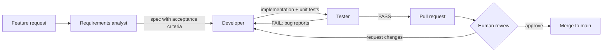

# agent-pipeline-sandbox

A sandbox for a **multi-agent development pipeline** built with [Claude Code](https://code.claude.com/docs/en/overview) subagents. A feature request in plain language goes in, and a reviewed, tested pull request comes out. A human stays in the loop as the only approver.

The app itself is intentionally small: a task list in vanilla JavaScript. It exists to give the agents a real codebase to specify, build and test against.

## The pipeline



| Stage | Agent | Output | Can modify |
|-------|-------|--------|-----------|
| Requirements | `requirements-analyst` | `docs/specs/<slug>.md` with numbered Given/When/Then acceptance criteria | Specs only |
| Development | `developer` | Implementation, unit tests, Conventional Commits | Source code and unit tests |
| Testing | `tester` | Acceptance tests traced to criterion IDs, `docs/test-reports/<slug>.md`, PASS/FAIL verdict | Tests and test reports only |
| Orchestration | `/feature` command | Routes work between agents and opens the PR | Nothing directly |

### Quality gates

- **Blocking questions stop the pipeline.** If a wrong guess would change the core behavior, the analyst asks before any code is written. Smaller gaps become documented assumptions for the reviewer to confirm.
- **Independent testing.** The tester gets the spec and the changed files, not the developer's reasoning, and judges the result against the spec.
- **Separation of duties.** The developer cannot edit acceptance tests, and the tester cannot edit production code.
- **Traceability.** Every acceptance criterion maps to at least one test, and the PR body includes the AC → test → result table.
- **Bounded fix loop.** At most three developer/tester rounds. Unresolved critical or major bugs turn the PR into a draft.
- **Human approval.** Agents cannot merge, approve or force-push (see `.claude/settings.json`), and `main` is protected on GitHub.

## Getting started

Requirements: Node.js 22.12+, [Claude Code](https://code.claude.com/docs/en/setup), and the [GitHub CLI](https://cli.github.com/) logged in with `gh auth login`.

```bash
npm install
npx playwright install chromium
npm run test:all
```

### Run the pipeline

```bash
claude --worktree my-feature
```

Then, inside Claude Code:

```
/feature let users mark a task as done, and show done tasks with a strikethrough
```

`--worktree` runs the session in an isolated checkout on its own branch, so several features can run in parallel without touching each other.

## Ideas for first runs

- Mark a task as done / undo
- Delete a task
- Persist tasks across reloads with `localStorage`
- Filter: all / active / done
- Edit a task title inline

## Project structure

```
.claude/
  agents/            requirements-analyst, developer, tester
  skills/feature/    the /feature orchestration command
  settings.json      permission rules (no merge, no force push)
.github/workflows/   CI: build, unit tests, end-to-end tests
docs/specs/          specs produced by the analyst
docs/test-reports/   reports produced by the tester
src/                 app code (tasks.js = logic, main.js = DOM)
tests/unit/          Vitest
tests/e2e/           Playwright
```
